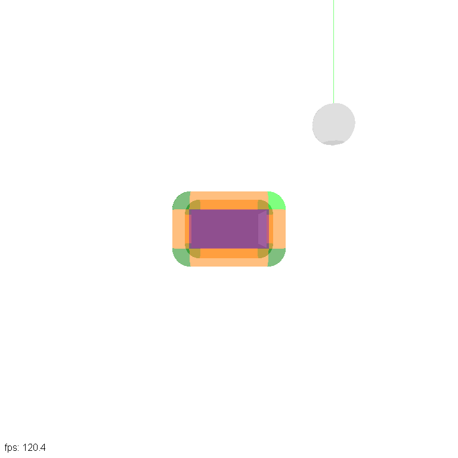
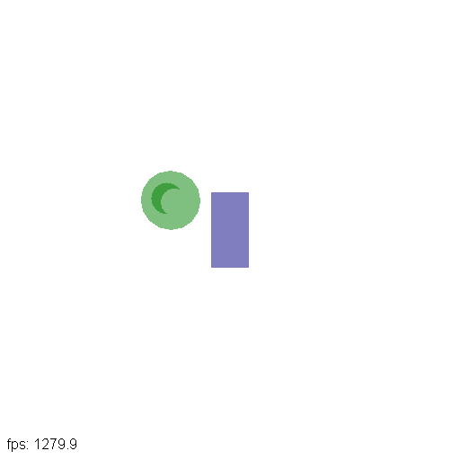
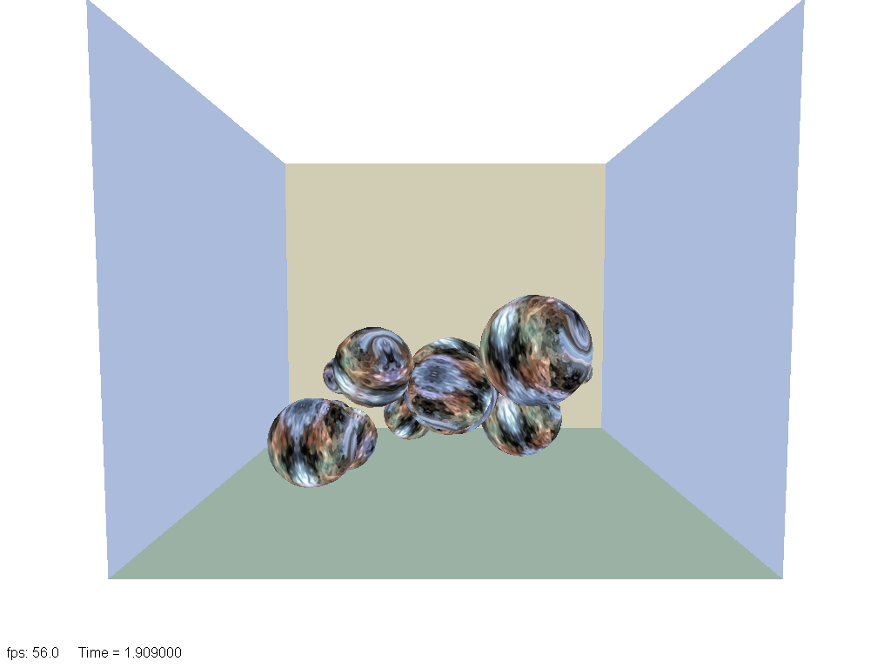

# Geometry_Collision

Collision and distance queries between simple 3D primitives, with three interactive demos: point to box distance, line/ray to box, sphere against an axis-aligned or oriented box (static and moving), and impulse-based rigid-sphere physics. The code is based on David Eberly's [Geometric Tools](https://www.geometrictools.com) (GTE and GTL) and lives in one namespace, `Vector_GM`, on top of an unmodified GTE 6.6.

| Moving sphere vs. box (`moving`) | Box vs. sphere (`boxsphere`) | Bouncing spheres (`bounce`) |
|---|---|---|
|  |  |  |

Screenshots: Linux build, OpenGL 4.5 (Mesa llvmpipe).

---

## Origin of the code

Almost all of the source here is Geometric Tools code by David Eberly, used under the [Boost Software License 1.0](licenses/BSL-1.0.txt). [THIRD_PARTY_NOTICES.txt](THIRD_PARTY_NOTICES.txt) has the file-by-file list.

| Location | Origin | Changes made in this repository |
|---|---|---|
| `Geometry_Collision/Mathematics/`, `Graphics/`, `Applications/` | GTE 6.6 (davideberly/GeometricTools commit 0a528c6, 2023-05-25) | None: byte-identical to upstream, namespace `gte` |
| Geometry headers: `AlignedBox.h`, `OrientedBox.h`, `CanonicalBox.h`, `Line.h`, `Ray.h`, `HyperPlane.h`, `DistPoint*.h`, `Intr*.h`, `DCPQuery.h`, `FIQuery.h`, `TIQuery.h`, `IntrIntervals.h`, `RigidBody.h` | Copies of GTE `Mathematics/` headers | Namespace `Vector_GM`, includes to the copies in this folder, bug fixes listed in each file header |
| `Constants.h`, `Exceptions.h`, `typeTraits_GM.h`, `HyperSphere.h` | GTL (Geometric Tools Library) | Namespace `gtl` renamed to `Vector_GM`, `Vector<T, N>` changed to GTE's `Vector<N, T>` |
| `Vector.h` | Written here | Makes GTE's `Vector<N, T>`, `Vector2/3/4` and their free functions visible in `Vector_GM`; no second vector class |
| `BouncingSpheresWindow.*`, `BoxSphereIntersectionWindow.*`, `MovingSphereBoxWindow.*`, `PhysModule.*`, `RigidPlane.*`, `RigidSphere.*` | GTE samples *Physics/BouncingSpheres*, *Intersection/IntersectBoxSphere*, *Intersection/MovingSphereBox* | Use the `Vector_GM` queries; sphere inertia fixed to (2/5)·m·r² |
| `Geometry_Collision.cpp` | Written here | Demo launcher: `Geometry_Collision [moving \| boxsphere \| bounce]` |
| `CMakeLists.txt`, `CMakePresets.json`, `cmake/`, `tests/`, `.github/`, `docs/` | Written here | Build, tests, CI, screenshots |

## Repository layout

```
CMakeLists.txt, CMakePresets.json   CMake build (see below)
cmake/header_check.cpp.in           template for the header self-containment check
tests/smoke_tests.cpp               Constants.h, typeTraits_GM.h, Exceptions.h
tests/geometry_tests.cpp            numeric tests of the distance/intersection queries
tests/test_harness.h                minimal check macros
docs/                               demo screenshots
Geometry_Collision/
  *.h                               geometry queries (namespace Vector_GM)
  *.cpp                             physics and demo windows
  Data/                             BallTextureWrap.png, Initial.txt (bouncing spheres)
  Mathematics/, Graphics/, Applications/   GTE 6.6, unmodified
licenses/BSL-1.0.txt                Boost Software License 1.0
THIRD_PARTY_NOTICES.txt             attribution, file by file
```

## Building

Requires CMake 3.20 or newer and a C++17 compiler (MSVC 2022, GCC 11 or newer, Clang 14 or newer).

### Visual Studio 2022

Either open the folder (**File > Open > Folder**): Visual Studio reads `CMakePresets.json`, pick **x64 Debug** or **x64 Release**, then select `Geometry_Collision.exe` as the startup item. Or generate a solution:

```bat
cmake --preset vs2022
cmake --build --preset vs2022-release
out\build\vs2022\Release\Geometry_Collision.exe bounce
```

The Windows presets turn on `GC_BUILD_APP`; the demo uses the GTE DirectX 11 backend.

### Linux

The demo uses the GTE OpenGL 4.5 / GLX backend:

```bash
sudo apt-get install libx11-dev libgl-dev libopengl-dev libegl-dev libpng-dev
cmake -B build -DCMAKE_BUILD_TYPE=Release -DGC_BUILD_APP=ON
cmake --build build --parallel
ctest --test-dir build --output-on-failure
./build/Geometry_Collision moving
```

Without `-DGC_BUILD_APP=ON` only the geometry library, header checks and tests are built, with no graphics dependencies.

| Target | What it is |
|---|---|
| `gc_geometry` | Header-only INTERFACE target, include root `Geometry_Collision/` (so `Mathematics/Math.h` never shadows `<math.h>`) |
| `gc_header_check` | Compiles each geometry header in its own translation unit, included twice (self-containment and include guard) |
| `gc_smoke_tests`, `gc_geometry_tests` | CTest `smoke_tests` and `geometry_tests` (216 checks with hand-computed expected values: inside, touching, separated, corner/edge/face contact, degenerate boxes, float and double) |
| `gc_gte_graphics`, `gc_gte_applications` | GTE Graphics and Applications as static libraries (DX11 + MSW on Windows, GL45 + GLX on Linux); only with `GC_BUILD_APP=ON` |
| `Geometry_Collision` | The demo application; only with `GC_BUILD_APP=ON` |

CI (`.github/workflows/build.yml`) builds everything, including the demo, with MSVC 2022 on Windows and GCC on Linux, and runs the tests.

## Demos

| Command | GTE sample | What it shows | Keys |
|---|---|---|---|
| `Geometry_Collision moving` (default) | *Intersection/MovingSphereBox* | A sphere moving toward a box; first contact time and point from `FIQuery<AlignedBox3, Sphere3>` (`APP_USE_OBB` switches to `OrientedBox3`) | `a`/`A` velocity angle θ, `b`/`B` angle φ, `x y z`/`X Y Z` move the sphere, `e` run the query, `s` toggle the moving sphere, `w` wireframe |
| `Geometry_Collision boxsphere` | *Intersection/IntersectBoxSphere* | Oriented box and sphere; colour shows `TIQuery<OrientedBox3, Sphere3>` | `x y z`/`X Y Z` move the box, `p r h`/`P R H` rotate it about its axes, `w` wireframe |
| `Geometry_Collision bounce` | *Physics/BouncingSpheres* | Rigid spheres in a box, impulse-based collision response | `s` single-step mode, space next step, `w` wireframe |

In all three the mouse rotates the scene (GTE trackball) and the arrow keys move the camera.

## What the port changed

The previous state mixed GTE, GTL and a half-renamed `Vector_GM` and did not compile. Fixed in this branch:

1. One vector type: GTE's `Vector<N, T>`, made visible in `Vector_GM` by `Vector.h`; the GTL `Vector<T, N>` copy is gone.
2. Every root header is in `namespace Vector_GM`; the vendored GTE folders are restored to upstream and stay in `gte`.
3. `TIQuery.h` declares `TIQuery` (it contained a copy of `FIQuery`).
4. Duplicate specialisations removed (`InterRayAlignedBox.h`, `QueryBoundedBox.h`).
5. Include names match the files on case-sensitive file systems (`RigidSphere.h`, `HyperPlane.h`, `HyperSphere.h`).
6. `BouncingSpheresWindow.cpp` implemented (it was a copy of the header); `main()` launches the three demos.
7. `Hyperplane<N>` from N points (N != 3): the SVD call used an invalid argument and the matrix storage order depended on `GTE_USE_ROW_MAJOR`; both fixed and tested.
8. Rigid-sphere inertia: (2/5)·m·r²·I instead of `massDensity * I`.
9. The Visual Studio 2015-era `.sln`/`.vcxproj` (which could not link the GTE sources and prepended VS 2015 headers) replaced by CMake, which Visual Studio 2022 opens directly.

## License

The Geometric Tools code (almost all of this repository) is licensed under the Boost Software License 1.0 ([licenses/BSL-1.0.txt](licenses/BSL-1.0.txt)), copyright David Eberly, Geometric Tools. See [THIRD_PARTY_NOTICES.txt](THIRD_PARTY_NOTICES.txt). The OpenGL headers in `Graphics/GL45/GL/` are copyright The Khronos Group and carry their own license. No separate license has been chosen yet for the repository owner's own additions.
